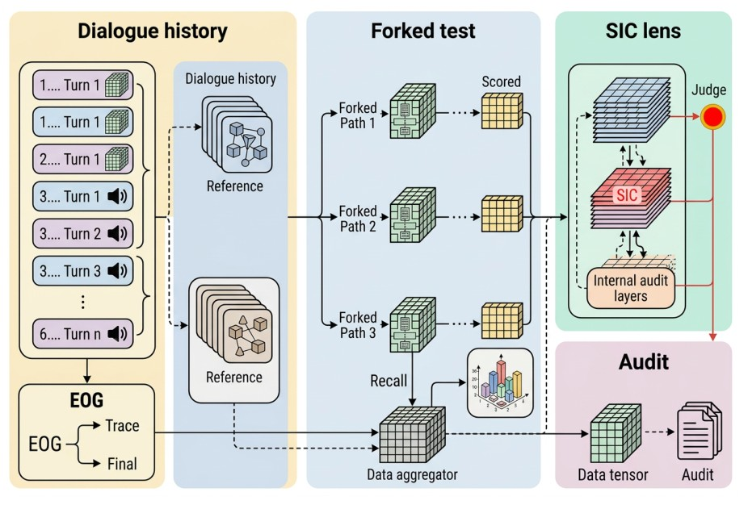

<div align="center">

# When LLMs Forget What They Believe: Characterizing State Integrity Collapse in Long-Horizon Dialogues

**Yancheng Zhu** · **Yifan Yuan**<sup>&dagger;</sup>

School of Artificial Intelligence, Shenzhen University
<br>
<sup>&dagger;</sup>Corresponding author

**EMNLP 2026 (Main Conference)**

<a href="https://arxiv.org/abs/2610.31314"></a>
<a href="#-released-artifacts"></a>
<a href="#-reproduce-the-paper-offline"></a>
<a href="LICENSE_DATA_AND_CODE.txt"></a>

</div>

<p align="center"><br><em>StateTrack-Bench evaluation protocol: a persistent constraint is planted in the dialogue, probed at increasing depths, and every failure is re-examined with a forked recall test.</em></p>

**TL;DR:** An assistant can **repeat a user's rule and still stop obeying it**. We call this recall–compliance dissociation **State Integrity Collapse (SIC)**: the model keeps the constraint in memory but no longer applies it to later turns — unlike ordinary forgetting, longer context or memory retrieval does not fix it. **StateTrack-Bench** plants one persistent constraint (numerical, format, role/persona, factual-memory or logical-rule) in a conversation, checks compliance at increasing dialogue depths, and uses a **forked recall audit** to separate forgetting from remembering-without-complying. Across seven provider-pinned models, **88.6% of failures are behavioral drift rather than forgetting**, and **Structured State Anchoring (SSA)** recovers up to **24.4 points**.

## 🔍 StateTrack-Bench

- **Persistent constraints** of five types — numerical, format, role/persona, factual-memory and logical-rule — are stated early in a dialogue and must govern every later answer.
- **Depth probes** check strict joint retention (immediate task + persistent constraint) at turns 3, 5, 7, 10 and 12, and in extended evaluations up to 50 turns.
- **Forked recall audit.** For every non-retained answer, a recall probe is replayed on a copy of the dialogue prefix: if the model can still state the constraint, the failure is an integrity failure (SIC+), otherwise ordinary forgetting (SIC−).
- **Structured State Anchoring (SSA).** A training-free mitigation: an `[ACTIVE_STATE]` block is prepended at each turn, constraints are rewritten as verifiable predicates, and outputs are checked with up to two retries.

## 🚀 Reproduce the Paper Offline

All reported tables are reconstructed from the cached outputs with the Python standard library — no API key, no network:

```bash
git clone https://github.com/MUSE-AI-Lab/StateTrack.git
cd StateTrack
python tools/reproduce_reported_metrics.py      # retention table, dynamic-state, depth-50, two-constraint and checker audits
python scripts/sgd_ecological_pilot/reproduce_pilot_metrics.py   # SGD dialogue pilot
python -m unittest discover -s tests -v         # consistency checks over the stored results
python tools/verify_checksums.py                # integrity of every released file
python verify_package.py                        # exact package membership
```

The expected output of the first command is stored in [`reproduced_metrics.txt`](reproduced_metrics.txt).

## 📊 Main Results

<table>
<tr><td valign="top">

**Strict joint retention (%)** — mean over five constraint types and five depths (Table 3)

| Model | Overall | Turn 3 | Turn 12 |
|:-|:-:|:-:|:-:|
| DeepSeek-v4-Flash | 100.0 | 100.0 | 100.0 |
| GPT-5.4-mini | 98.4 | 96.0 | 100.0 |
| DeepSeek-v4-Pro | 96.0 | 92.0 | 96.0 |
| Qwen3.6-Plus | 95.2 | 92.0 | 96.0 |
| GPT-5.4 | 94.4 | 100.0 | 96.0 |
| Claude-Sonnet-4-6 | 90.4 | 92.0 | 88.0 |
| Gemini-3.1-Pro | 62.4 | 64.0 | 54.0 |

</td><td valign="top">

**Structured State Anchoring** — retention (%) at depth 12 (Table 14)

| Model | Baseline | + SSA | Δ |
|:-|:-:|:-:|:-:|
| GPT-5.4 | 96.0 | 99.2 | +3.2 |
| Claude-Sonnet-4-6 | 88.0 | 96.0 | +8.0 |
| Gemini-3.1-Pro | 54.0 | 78.4 | **+24.4** |
| Qwen3.6-Plus | 96.0 | 98.4 | +2.4 |

</td></tr>
</table>

The forked recall audit attributes **88.6%** of the observed failures to behavioral drift (84.4% when the most brittle model is excluded). Model snapshot identifiers are listed in [`metadata/snapshot_manifest.csv`](metadata/snapshot_manifest.csv).

## 📦 Released Artifacts

| Folder | Content |
|:-|:-|
| `results/core/` | aggregate retention cache behind Tables 2 and 3 (7 models × 5 depths) |
| `results/rebuttal/` | 70-output audit (task success, constraint compliance, recall, SIC+ / SIC−), 105-output update / revocation experiment, 216-probe symbolic-depth analysis, 34-output two-constraint analysis, execution audit for the depth-50 results |
| `results/checker_calibration/` | two independently worded temperature-0 model-assisted checker passes over the 70 audit rows, disagreement adjudication and agreement report |
| `results/ecological_pilot/` | pilot on human-authored Schema-Guided Dialogue conversations: 30 cases × 7 models with behavior and recall responses ([details](results/ecological_pilot/README.md)) |

## 🧪 Re-running the Experiments

Re-running model generation needs your own provider credentials. Copy the template and fill in OpenAI-compatible endpoints and keys (never commit this file):

```bash
cp experiment_config.example.json experiment_config.json
python scripts/paper1_state_collapse/run_rebuttal_experiments.py
python scripts/paper1_state_collapse/run_symbolic_depth_audit.py
python scripts/paper1_state_collapse/run_multiconstraint_audit.py
python scripts/paper1_state_collapse/run_model_assisted_checker_audit.py --max-workers 16
```

Hosted model endpoints change over time, so fresh runs can differ from the cached outputs.

## 📁 Repository Structure

```text
results/                     # cached outputs and summaries (see above)
scripts/
├── common/                  # OpenAI-compatible LLM caller and JSON judge
├── paper1_state_collapse/   # runners of the follow-up audits and checker calibration
└── sgd_ecological_pilot/    # SGD pilot prompts, summary and reproduction
tools/                       # offline metric reproduction and checksum verification
tests/                       # consistency tests over the stored results
metadata/                    # model snapshot identifiers
assets/                      # figures
```

## 📝 Citation

```bibtex
@inproceedings{zhu2026statetrack,
  title     = {When {LLMs} Forget What They Believe: Characterizing State Integrity Collapse in Long-Horizon Dialogues},
  author    = {Zhu, Yancheng and Yuan, Yifan},
  booktitle = {Proceedings of the 2026 Conference on Empirical Methods in Natural Language Processing (EMNLP)},
  year      = {2026},
  eprint    = {2610.31314},
  archivePrefix = {arXiv}
}
```

## 📄 License

Code is released under the [MIT License](LICENSE); the authored benchmark scenarios and derived metadata under [CC BY 4.0](LICENSE_DATA_AND_CODE.txt). Cached model outputs remain subject to the respective providers' terms, and the Schema-Guided Dialogue source data is not redistributed.
