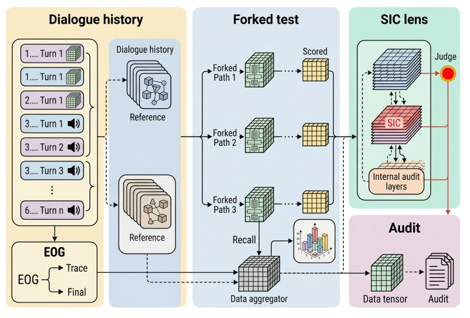

<div align="center">

# When LLMs Forget What They Believe: Characterizing State Integrity Collapse in Long-Horizon Dialogues

**Yancheng Zhu** · **Yifan Yuan**<sup>&dagger;</sup>

School of Artificial Intelligence, Shenzhen University
<br>
<sup>&dagger;</sup>通讯作者

**EMNLP 2026（主会）**

<a href="https://arxiv.org/abs/2610.31314"></a>
<a href="#-已发布资源"></a>
<a href="#-离线复现论文结果"></a>
<a href="LICENSE_DATA_AND_CODE.txt"></a>

[English](README.md) · [简体中文](README_zh.md)

</div>

<p align="center"><br><em>StateTrack-Bench 评测协议：在对话中植入一条持久约束，在逐步加深的对话深度上进行探测，并用分叉式回忆测试复查每一次失败。</em></p>

**一句话总结：** 助手有时**能复述用户定下的规则，却不再遵守它**。我们把这种回忆与遵循相分离的现象称为**状态完整性崩塌（State Integrity Collapse，SIC）**：模型仍记得约束，却不再把它应用到后续轮次中。与普通遗忘不同，加长上下文或引入记忆检索都无法解决这一问题。**StateTrack-Bench** 在对话中植入一条持久约束（数值、格式、角色/人设、事实记忆或逻辑规则），在逐步加深的对话深度上检查模型是否遵守，并通过**分叉式回忆审计**区分“遗忘”与“记得但不遵守”。在七个锁定了服务商与快照版本的模型上，**88.6% 的失败源于行为漂移而非遗忘**；**Structured State Anchoring (SSA)** 最多可将保持率提升 **24.4 个百分点**。

## 🔍 StateTrack-Bench

- **持久约束**共五类：数值、格式、角色/人设、事实记忆和逻辑规则。约束在对话早期给出，此后的每一个回答都必须遵守。
- **深度探针**在第 3、5、7、10、12 轮检查严格联合保持（当前任务与持久约束须同时满足），扩展评测中最多延伸至 50 轮。
- **分叉式回忆审计。** 对每个未能保持约束的回答，在对话前缀的副本上重放一次回忆探针：若模型仍能说出该约束，则该失败属于完整性失效（SIC+），否则属于普通遗忘（SIC−）。
- **Structured State Anchoring (SSA)。** 一种无需训练的缓解方法：每一轮都在开头插入 `[ACTIVE_STATE]` 块，把约束改写为可验证的谓词，并对输出进行检查，最多重试两次。

## 🚀 离线复现论文结果

论文中报告的所有表格都可以仅用 Python 标准库从缓存输出中重建，无需 API 密钥，也无需联网：

```bash
git clone https://github.com/MUSE-AI-Lab/StateTrack.git
cd StateTrack
python tools/reproduce_reported_metrics.py      # 保持率表、动态状态、深度 50、双约束与检查器审计
python scripts/sgd_ecological_pilot/reproduce_pilot_metrics.py   # SGD 对话试点实验
python -m unittest discover -s tests -v         # 对已存结果做一致性检查
python tools/verify_checksums.py                # 校验每个已发布文件的完整性
python verify_package.py                        # 核对发布包的文件清单
```

第一条命令的预期输出保存在 [`reproduced_metrics.txt`](reproduced_metrics.txt) 中。

主要的保持率曲线现由 `results/core/all_results.json` 中的 **175 条场景级缓存记录**重新计算，再与已发布的汇总缓存进行核对。已发布的核心与增强场景库、原始运行脚本源码，以及完整的生成/重放说明均记录在 [REPRODUCIBILITY.md](REPRODUCIBILITY.md) 中。

## 运行核心基准与增强基准

两个场景库均已公开：**25 个核心场景**和 **50 个增强场景**，覆盖五类约束。运行脚本保留了原始的 12 轮对话安排、探针深度 `[3, 5, 7, 10, 12]`、填充消息和正则检查器。以下命令只需 Python 3.10+ 即可运行：

```bash
# 查看全部场景及计划的探针数量，无需凭据，也不调用 API。
python scripts/run_benchmark.py --suite core --dry-run --output outputs/core-plan
python scripts/run_benchmark.py --suite augmented --dry-run --output outputs/augmented-plan

# 由场景级记录（而非汇总表）重新计算指标。
python scripts/run_benchmark.py --suite core --replay results/core/all_results.json --output outputs/core-replay
python scripts/run_benchmark.py --suite augmented --replay results/augmented/all_results.json --output outputs/augmented-replay

# 配置 OPENAI_API_KEY 后生成新的模型输出。
python scripts/run_benchmark.py --suite core --model YOUR_MODEL_ID --output outputs/new-core
python scripts/run_benchmark.py --suite augmented --model YOUR_MODEL_ID --output outputs/new-augmented
```

使用相同的参数和输出目录并加上 `--resume`，即可跳过已完成的对话。`--state-type`、`--scenario-index`、`--limit` 和 `--concurrency` 可用于小规模运行。`OPENAI_BASE_URL` 或 `--base-url` 用于选择显式配置的兼容服务商，默认使用 OpenAI 官方 API。全新运行会把完整对话、探针标签、带版本号的场景清单和重建的指标保存在被 Git 忽略的 `outputs/` 目录下。历史缓存记录只包含探针预览和标签，不含完整对话；重放可复现其原始评分，而重新生成则会产生新的证据。

## 📊 主要结果

<table>
<tr><td valign="top">

**严格联合保持率（%）**：五类约束、五个深度上的平均值（论文表 3）

| 模型 | 总体 | 第 3 轮 | 第 12 轮 |
|:-|:-:|:-:|:-:|
| DeepSeek-v4-Flash | 100.0 | 100.0 | 100.0 |
| GPT-5.4-mini | 98.4 | 96.0 | 100.0 |
| DeepSeek-v4-Pro | 96.0 | 92.0 | 96.0 |
| Qwen3.6-Plus | 95.2 | 92.0 | 96.0 |
| GPT-5.4 | 94.4 | 100.0 | 96.0 |
| Claude-Sonnet-4-6 | 90.4 | 92.0 | 88.0 |
| Gemini-3.1-Pro | 62.4 | 64.0 | 54.0 |

</td><td valign="top">

**Structured State Anchoring**：深度 12 处的保持率（%，论文表 14）

| 模型 | 基线 | + SSA | Δ |
|:-|:-:|:-:|:-:|
| GPT-5.4 | 96.0 | 99.2 | +3.2 |
| Claude-Sonnet-4-6 | 88.0 | 96.0 | +8.0 |
| Gemini-3.1-Pro | 54.0 | 78.4 | **+24.4** |
| Qwen3.6-Plus | 96.0 | 98.4 | +2.4 |

</td></tr>
</table>

分叉式回忆审计将观察到的失败中的 **88.6%** 归因于行为漂移（排除最脆弱的模型后为 84.4%）。各模型的快照标识符见 [`metadata/snapshot_manifest.csv`](metadata/snapshot_manifest.csv)。

## 📦 已发布资源

| 目录 | 内容 |
|:-|:-|
| `results/core/` | 论文表 2 和表 3 所依据的汇总保持率缓存（7 个模型 × 5 个深度） |
| `results/rebuttal/` | 70 条输出的审计（任务成功、约束遵守、回忆、SIC+ / SIC−）；105 条输出的约束更新/撤销实验；216 个探针的符号深度分析；34 条输出的双约束分析；深度 50 结果的执行审计 |
| `results/checker_calibration/` | 对 70 条审计记录进行的两轮模型辅助检查（温度为 0，两轮提示词措辞相互独立），以及分歧裁定和一致性报告 |
| `results/ecological_pilot/` | 在人工撰写的 Schema-Guided Dialogue 对话上开展的试点实验：30 个案例 × 7 个模型，包含行为回答与回忆回答（[详情](results/ecological_pilot/README.md)） |

## 🧪 重新运行实验

重新生成模型输出需要使用你自己的模型服务凭据。复制模板文件，并填写兼容 OpenAI 的接口地址和密钥（切勿提交该文件）：

```bash
cp experiment_config.example.json experiment_config.json
python scripts/paper1_state_collapse/run_rebuttal_experiments.py
python scripts/paper1_state_collapse/run_symbolic_depth_audit.py
python scripts/paper1_state_collapse/run_multiconstraint_audit.py
python scripts/paper1_state_collapse/run_model_assisted_checker_audit.py --max-workers 16
```

托管模型的接口会随时间变化，因此重新运行的结果可能与缓存输出不同。

## 📁 仓库结构

```text
results/                     # 缓存的输出与汇总（见上文）
scripts/
├── common/                  # 兼容 OpenAI 接口的大模型调用器与 JSON 评判器
├── paper1_state_collapse/   # 后续审计与检查器校准的运行脚本
└── sgd_ecological_pilot/    # SGD 试点实验的提示词、汇总与复现
tools/                       # 离线复现指标与校验和验证
tests/                       # 针对已存结果的一致性测试
metadata/                    # 模型快照标识符
assets/                      # 图片
```

## 📝 引用

```bibtex
@inproceedings{zhu2026statetrack,
  title     = {When {LLMs} Forget What They Believe: Characterizing State Integrity Collapse in Long-Horizon Dialogues},
  author    = {Zhu, Yancheng and Yuan, Yifan},
  booktitle = {Proceedings of the 2026 Conference on Empirical Methods in Natural Language Processing (EMNLP)},
  year      = {2026},
  eprint    = {2610.31314},
  archivePrefix = {arXiv}
}
```

## 📄 许可证

代码以 [MIT 许可证](LICENSE)发布；我们编写的基准场景及派生元数据以 [CC BY 4.0](LICENSE_DATA_AND_CODE.txt) 发布。缓存的模型输出仍受各模型服务商条款的约束，Schema-Guided Dialogue 的源数据不在本仓库中再分发。
